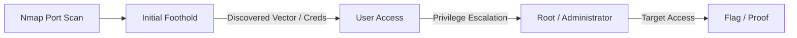

## Description & Client Objective
> {{Paste the brief description and objective from HTB Academy here.}}

---

## Attack Path (Kill Chain)



---

## 1. Initial Reconnaissance & Port Scanning

Fast TCP port discovery:
```shell
sudo nmap -p- --min-rate=5000 $ip -Pn
```

### Open Ports & Services:
| Port     | Service | Version / Banner | Initial Thoughts / Attack Vector              |
| :------- | :------ | :--------------- | :-------------------------------------------- |
| `xx/tcp` | service | version          | Potensi anonymous login / exploit / misconfig |

---

## 2. Service Enumeration & Initial Foothold

### Investigation:
{{Explain what service was checked and why.}}

```shell
{{commands_used_to_enumerate}}
```

### Findings / Credentials:
* **Username:** `user`
* **Password:** `pass`
* **Notes:** {{Any sensitive file, config, or banner info discovered}}

---

## 3. Privilege Escalation (PrivEsc)
*(Optional / Jika ada di lab Medium & Hard)*

### Vector Identified:
{{What was the flaw? E.g., Password reuse, misconfigured share, sudo rights, SUID, weak service}}

```shell
{{commands_used_for_privesc}}
```

> [!SUCCESS] High Privilege Obtained
> User elevated from `low_priv_user` ➔ `root` / `Administrator` (`Pwn3d!`).

---

## 4. Objective / Flag Extraction

```shell
{{final_commands_to_retrieve_flag_or_proof}}
```

---

# Flag / Proof : `{{FLAG_OR_CREDENTIAL_HERE}}`

---

## 5. Why This Happened (Root Cause & Human Error)
* **Akar Masalah:** {{Penjelasan 1-2 kalimat kenapa server bisa punya celah ini, misal: Admin malas bikin password beda / lupa pasang filter IP.}}
* **Dampak Bisnis:** {{Data apa yang bocor atau kontrol apa yang hilang.}}

---

## 6. Key Takeaways & Lessons Learned
* **Hal Baru yang Dipelajari:** {{Tools atau sintaks baru yang terbukti ampuh.}}
* **Jalan Buntu (Rabbit Holes) yang Dihindari:** {{Hal yang sempat dicoba tapi ternyata tidak efektif.}}

---

## Related Concepts : 
[[{{Tool_1}}]], [[{{Command_1}}]], [[{{Protocol_1}}]]
